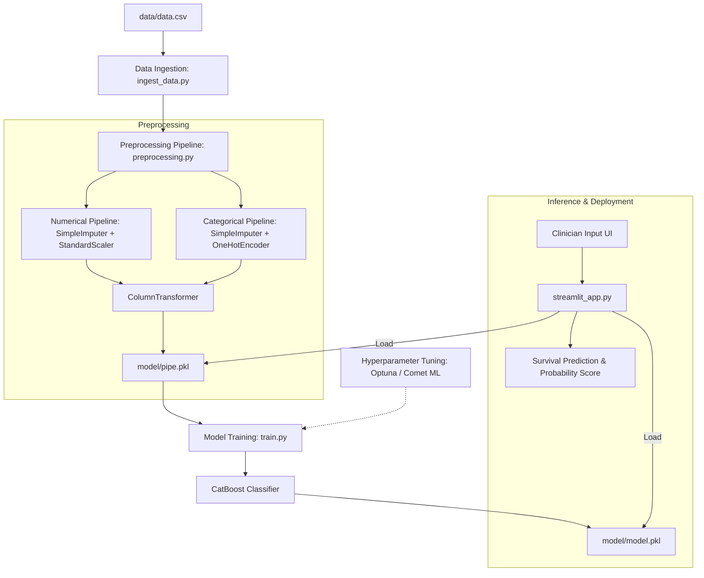
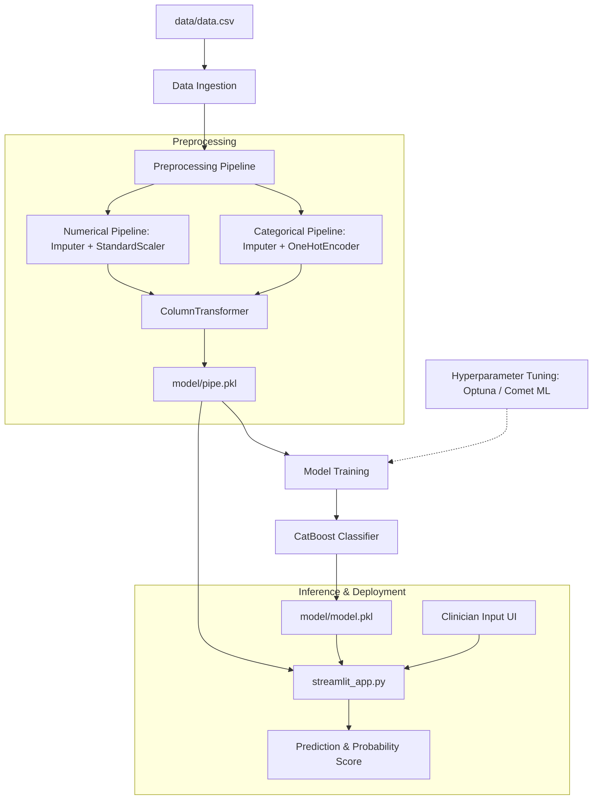

# 🎗️ Breast Cancer Survival Prediction System


An end-to-end clinical machine learning system that predicts breast cancer patient survival prognosis based on patient demographics, histology, receptor status, surgical intervention details, and protein biomarker expressions.

---

## 📌 Table of Contents

- [Overview & Clinical Motivation](#-overview--clinical-motivation)
- [Key Features](#-key-features)
- [System Architecture](#-system-architecture)
- [Dataset & Feature Description](#-dataset--feature-description)
- [Project Structure](#-project-structure)
- [Getting Started](#-getting-started)
  - [Prerequisites](#prerequisites)
  - [Installation](#installation)
- [Running the Project](#-running-the-project)
  - [1. Launching the Web Application](#1-launching-the-web-application)
  - [2. Running the Training Pipeline](#2-running-the-training-pipeline)
  - [3. Exploratory Data Analysis (EDA)](#3-exploratory-data-analysis-eda)
- [Machine Learning Workflow](#-machine-learning-workflow)
- [Model Evaluation & Interpretability](#-model-evaluation--interpretability)
- [Contributing](#-contributing)
- [License](#-license)

---

## 🔬 Overview & Clinical Motivation

Breast cancer prognosis assessment is critical for personalized oncology treatment planning. By examining protein biomarkers (`Protein1` through `Protein4`) alongside classic clinical parameters (tumor stage, histology, surgical procedure, estrogen receptor [ER], progesterone receptor [PR], and human epidermal growth factor receptor 2 [HER2] status), this project provides probabilistic survival predictions (**Alive** vs **Deceased**) to assist clinical decision-making.

---

## ✨ Key Features

- **Production-Ready Web App:** Modern, responsive [Streamlit](https://streamlit.io/) interface for instant interactive risk and survival probability prediction.
- **Robust Feature Preprocessing Pipeline:** Automated imputation (`mean` for numeric, `most_frequent` for categorical), standard scaling, and one-hot encoding integrated via Scikit-Learn `ColumnTransformer`.
- **Gradient Boosted Inference:** Optimized with **CatBoost Classifier**, providing superior handling of tabular categorical data and calibrated probability estimates.
- **Modular Pipeline Design:** Clean separation of concerns with dedicated ingestion, preprocessing, training, hyperparameter optimization, and logging modules.
- **Cross-Version Resilience:** Built-in backward compatibility for serialized model pipelines across varying Scikit-Learn releases.

---

## 🏗️ System Architecture



---

## 📊 Dataset & Feature Description

The model is trained on clinical breast cancer patient records. The target variable is `Patient_Status` (`Alive` or `Dead`).

| Feature | Type | Description | Values / Range |
| :--- | :--- | :--- | :--- |
| `Age` | Numerical | Age of the patient at the time of diagnosis | 18 – 100+ years |
| `Gender` | Categorical | Patient biological sex | `FEMALE`, `MALE` |
| `Protein1` | Numerical | Expression level of protein biomarker 1 | Continuous normalized value |
| `Protein2` | Numerical | Expression level of protein biomarker 2 | Continuous normalized value |
| `Protein3` | Numerical | Expression level of protein biomarker 3 | Continuous normalized value |
| `Protein4` | Numerical | Expression level of protein biomarker 4 | Continuous normalized value |
| `Tumour_Stage` | Categorical | Stage of cancer advancement | `I`, `II`, `III` |
| `Histology` | Categorical | Microscopic tumor tissue classification | `Infiltrating Ductal Carcinoma`, `Infiltrating Lobular Carcinoma`, `Mucinous Carcinoma` |
| `ER status` | Categorical | Estrogen Receptor status | `Positive`, `Negative` |
| `PR status` | Categorical | Progesterone Receptor status | `Positive`, `Negative` |
| `HER2 status` | Categorical | HER2 protein expression status | `Positive`, `Negative` |
| `Surgery_type` | Categorical | Type of surgical intervention performed | `Lumpectomy`, `Modified Radical Mastectomy`, `Simple Mastectomy`, `Other` |

---

## 📁 Project Structure

```text
Breast-Cancer-Survival-Prediction/
│
├── data/
│   └── data.csv                        # Raw clinical dataset
│
├── model/
│   ├── model.pkl                       # Serialized CatBoost classifier
│   └── pipe.pkl                        # Fitted ColumnTransformer pipeline
│
├── notebook/
│   └── breast-cancer-prediction-with-eda.ipynb  # Exploratory data analysis & experiments
│
├── src/
│   ├── __init__.py                     # Package initialization
│   ├── ingest_data.py                  # Dynamic data loading & validation
│   ├── preprocessing.py                # Preprocessing pipeline and train/test splitting
│   ├── hyperparameters.py              # Optuna & Comet ML hyperparameter tuning
│   ├── train.py                        # Model training routine and artifact export
│   └── logger.py                       # Structured console logging
│
├── catboost_info/                      # CatBoost training execution telemetry
├── requirements.txt                    # Project dependency specification
├── run_pipeline.py                     # Entry point for re-training pipeline
├── streamlit_app.py                    # Interactive Streamlit web application
├── LICENSE                             # MIT License
└── README.md                           # Documentation
```

---

## 🚀 Getting Started

### Prerequisites

- **Python:** Version `3.10` or higher
- **Git**

### Installation

1. **Clone the repository:**
   ```bash
   git clone https://github.com/<your-username>/Breast-Cancer-Survival-Prediction.git
   cd Breast-Cancer-Survival-Prediction
   ```

2. **Create and activate a virtual environment:**
   ```bash
   # On macOS/Linux:
   python3 -m venv venv
   source venv/bin/activate

   # On Windows (Command Prompt / PowerShell):
   python -m venv venv
   venv\Scripts\activate
   ```

3. **Install dependencies:**
   ```bash
   pip install --upgrade pip
   pip install -r requirements.txt
   ```

---

## 💻 Running the Project

### 1. Launching the Web Application

To experience the interactive prediction dashboard:

```bash
streamlit run streamlit_app.py
```

Once started, open your browser and navigate to:
```
http://localhost:8501
```

The app allows clinicians to adjust patient inputs and view:
- Categorical outcome: **Alive (Positive Prognosis)** vs **Dead (High Risk)**
- Calibrated probability percentages for survival vs mortality risk

### 2. Running the Training Pipeline

To re-train the model and regenerate the preprocessor pipeline:

```bash
python run_pipeline.py
```

This script:
1. Ingests data from `data/data.csv`
2. Constructs and fits the `ColumnTransformer` preprocessing pipeline
3. Trains the **CatBoost Classifier** on the encoded features
4. Exports updated artifacts to `model/pipe.pkl` and `model/model.pkl`

### 3. Exploratory Data Analysis (EDA)

Launch Jupyter to explore data distributions, correlations, feature importance, and deep learning experiments:

```bash
jupyter notebook notebook/breast-cancer-prediction-with-eda.ipynb
```

---

## 🧠 Machine Learning Workflow

1. **Missing Value Imputation:**
   - Numerical columns (`Age`, `Protein1-4`): Imputed with column mean.
   - Categorical columns (`Gender`, `Histology`, `Tumour_Stage`, etc.): Imputed with most frequent class.
2. **Feature Scaling & Encoding:**
   - Continuous numerical features scaled using `StandardScaler`.
   - Categorical values encoded via `OneHotEncoder(handle_unknown='ignore')`.
3. **Model Selection:**
   - CatBoost was selected for its native categorical robustness, resistance to overfitting on small medical datasets, and competitive log-loss performance.

---

## 📈 Model Evaluation & Interpretability

- **Metrics:** Evaluated primarily using **F1-Score (Weighted)**, **ROC-AUC**, and **Brier Score** to account for class imbalance (survival outcome skew).
- **Inference Speed:** Real-time sub-millisecond inference suitable for online diagnostic support tools.

---

## 🤝 Contributing
Md methun Hossain

Contributions are warmly welcomed! To contribute:

1. Fork the repository.
2. Create a feature branch: `git checkout -b feature/NewFeature`
3. Commit your changes: `git commit -m "Add new feature"`
4. Push to the branch: `git push origin feature/NewFeature`
5. Open a Pull Request.

---

## 📄 License

This project is licensed under the **MIT License** — see the [LICENSE](LICENSE) file for complete details.

<p align="center">
  Developed with ❤️ for Data Science & Oncology Research
</p>


---Bangla- Readme-file-
# 🎗️ Breast Cancer Survival Prediction System
## স্তন ক্যান্সার রোগীর বেঁচে থাকার সম্ভাবনা পূর্বাভাস ব্যবস্থা


  


এটি একটি End-to-End Clinical Machine Learning System, যা রোগীর বয়স, লিঙ্গ, টিউমারের ধরন ও পর্যায়, রিসেপ্টর স্ট্যাটাস, সার্জারির তথ্য এবং প্রোটিন বায়োমার্কারের মান বিশ্লেষণ করে স্তন ক্যান্সার রোগীর Survival Prognosis বা বেঁচে থাকার সম্ভাবনা পূর্বাভাস দেয়।

> **গুরুত্বপূর্ণ:** এই প্রকল্পটি শিক্ষামূলক ও গবেষণার উদ্দেশ্যে তৈরি। এটি চিকিৎসকের পরামর্শ, রোগ নির্ণয় বা চিকিৎসা-সংক্রান্ত সিদ্ধান্তের বিকল্প নয়।

---

## 📌 সূচিপত্র

- [প্রকল্প পরিচিতি ও চিকিৎসাগত গুরুত্ব](#-প্রকল্প-পরিচিতি-ও-চিকিৎসাগত-গুরুত্ব)
- [প্রধান বৈশিষ্ট্য](#-প্রধান-বৈশিষ্ট্য)
- [সিস্টেম আর্কিটেকচার](#-সিস্টেম-আর্কিটেকচার)
- [ডেটাসেট ও ফিচারের বিবরণ](#-ডেটাসেট-ও-ফিচারের-বিবরণ)
- [প্রজেক্ট ফোল্ডার স্ট্রাকচার](#-প্রজেক্ট-ফোল্ডার-স্ট্রাকচার)
- [শুরু করার নিয়ম](#-শুরু-করার-নিয়ম)
  - [প্রয়োজনীয় সফটওয়্যার](#প্রয়োজনীয়-সফটওয়্যার)
  - [ইনস্টলেশন](#ইনস্টলেশন)
- [প্রজেক্ট চালানোর নিয়ম](#-প্রজেক্ট-চালানোর-নিয়ম)
  - [১. ওয়েব অ্যাপ্লিকেশন চালু করা](#১-ওয়েব-অ্যাপ্লিকেশন-চালু-করা)
  - [২. মডেল ট্রেনিং পাইপলাইন চালানো](#২-মডেল-ট্রেনিং-পাইপলাইন-চালানো)
  - [৩. Exploratory Data Analysis (EDA)](#৩-exploratory-data-analysis-eda)
- [Machine Learning Workflow](#-machine-learning-workflow)
- [মডেল মূল্যায়ন ও ব্যাখ্যাযোগ্যতা](#-মডেল-মূল্যায়ন-ও-ব্যাখ্যাযোগ্যতা)
- [অবদান রাখুন](#-অবদান-রাখুন)
- [লাইসেন্স](#-লাইসেন্স)

---

## 🔬 প্রকল্প পরিচিতি ও চিকিৎসাগত গুরুত্ব

স্তন ক্যান্সারের রোগীর Prognosis মূল্যায়ন ব্যক্তিভিত্তিক Oncology Treatment Planning-এর একটি গুরুত্বপূর্ণ অংশ। এই প্রকল্পে `Protein1` থেকে `Protein4` পর্যন্ত প্রোটিন বায়োমার্কারের তথ্যের পাশাপাশি প্রচলিত Clinical Parameters বিশ্লেষণ করা হয়।

ব্যবহৃত Clinical Parameters-এর মধ্যে রয়েছে:

- Tumour Stage
- Histology
- Surgery Type
- Estrogen Receptor (ER) Status
- Progesterone Receptor (PR) Status
- Human Epidermal Growth Factor Receptor 2 (HER2) Status

এই তথ্যের ভিত্তিতে মডেল রোগীর সম্ভাব্য ফলাফল দুটি শ্রেণিতে পূর্বাভাস দেয়:

- **Alive:** রোগী জীবিত
- **Deceased/Dead:** রোগী মৃত

সিস্টেমটি Survival Probability বা বেঁচে থাকার সম্ভাবনার একটি আনুমানিক স্কোরও প্রদর্শন করে, যা গবেষণা ও শিক্ষামূলক বিশ্লেষণে সহায়ক হতে পারে।

---

## ✨ প্রধান বৈশিষ্ট্য

- **ইন্টারঅ্যাকটিভ ওয়েব অ্যাপ:** Streamlit ব্যবহার করে তৈরি আধুনিক ও ব্যবহারবান্ধব ইন্টারফেসের মাধ্যমে রোগীর তথ্য ইনপুট দিয়ে পূর্বাভাস দেখা যায়।
- **Feature Preprocessing Pipeline:** Numeric ডেটার জন্য Mean Imputation, Categorical ডেটার জন্য Most Frequent Imputation, Standard Scaling এবং One-Hot Encoding ব্যবহার করা হয়েছে।
- **CatBoost Classifier:** Tabular Data-এর ওপর Classification করার জন্য CatBoost ব্যবহার করা হয়েছে।
- **Modular Project Design:** Data Ingestion, Preprocessing, Model Training, Hyperparameter Optimization এবং Logging আলাদা মডিউলে সাজানো হয়েছে।
- **Model Compatibility:** বিভিন্ন Scikit-Learn Version-এ সংরক্ষিত Model Pipeline ব্যবহারের ক্ষেত্রে Backward Compatibility বিবেচনা করা হয়েছে।

---

## 🏗️ সিস্টেম আর্কিটেকচার

নিচের Flowchart-এ পুরো সিস্টেমের কাজের ধাপ দেখানো হয়েছে।



**সিস্টেমের কাজের সংক্ষিপ্ত ধাপ:**

1. `data/data.csv` ফাইল থেকে ডেটা সংগ্রহ করা হয়।
2. Data Ingestion Module ডেটা লোড ও যাচাই করে।
3. Preprocessing Pipeline Missing Values পূরণ, Scaling এবং Encoding সম্পন্ন করে।
4. CatBoost Classifier দিয়ে Model Training করা হয়।
5. Trained Model ও Preprocessing Pipeline সংরক্ষণ করা হয়।
6. Streamlit Web Application সংরক্ষিত Model ব্যবহার করে Prediction দেখায়।

---

## 📊 ডেটাসেট ও ফিচারের বিবরণ

এই মডেলটি Clinical Breast Cancer Patient Records ব্যবহার করে প্রশিক্ষণ দেওয়ার জন্য তৈরি। Target Variable হলো `Patient_Status`, যার শ্রেণি `Alive` অথবা `Dead`।

| Feature | ধরন | বিবরণ | সম্ভাব্য মান |
|---|---|---|---|
| `Age` | Numerical | রোগ নির্ণয়ের সময় রোগীর বয়স | ১৮–১০০+ বছর |
| `Gender` | Categorical | রোগীর জৈবিক লিঙ্গ | `FEMALE`, `MALE` |
| `Protein1` | Numerical | প্রোটিন বায়োমার্কার ১-এর Expression Level | Continuous Normalized Value |
| `Protein2` | Numerical | প্রোটিন বায়োমার্কার ২-এর Expression Level | Continuous Normalized Value |
| `Protein3` | Numerical | প্রোটিন বায়োমার্কার ৩-এর Expression Level | Continuous Normalized Value |
| `Protein4` | Numerical | প্রোটিন বায়োমার্কার ৪-এর Expression Level | Continuous Normalized Value |
| `Tumour_Stage` | Categorical | ক্যান্সারের অগ্রগতির পর্যায় | `I`, `II`, `III` |
| `Histology` | Categorical | টিউমার টিস্যুর মাইক্রোস্কোপিক শ্রেণিবিন্যাস | Infiltrating Ductal, Infiltrating Lobular, Mucinous Carcinoma |
| `ER status` | Categorical | Estrogen Receptor Status | `Positive`, `Negative` |
| `PR status` | Categorical | Progesterone Receptor Status | `Positive`, `Negative` |
| `HER2 status` | Categorical | HER2 Protein Expression Status | `Positive`, `Negative` |
| `Surgery_type` | Categorical | সম্পন্ন করা সার্জারির ধরন | Lumpectomy, Modified Radical Mastectomy, Simple Mastectomy, Other |

---

## 📁 প্রজেক্ট ফোল্ডার স্ট্রাকচার

```text
Breast-Cancer-Survival-Prediction/
│
├── data/
│   └── data.csv
│
├── model/
│   ├── model.pkl
│   └── pipe.pkl
│
├── notebook/
│   └── breast-cancer-prediction-with-eda.ipynb
│
├── src/
│   ├── __init__.py
│   ├── ingest_data.py
│   ├── preprocessing.py
│   ├── hyperparameters.py
│   ├── train.py
│   └── logger.py
│
├── catboost_info/
│
├── requirements.txt
├── run_pipeline.py
├── streamlit_app.py
├── LICENSE
└── README.md
```

### ফোল্ডার ও ফাইলের কাজ

| ফাইল/ফোল্ডার | কাজ |
|---|---|
| `data/` | মূল ডেটাসেট সংরক্ষণ করে |
| `model/` | Trained Model ও Preprocessing Pipeline রাখে |
| `notebook/` | EDA ও পরীক্ষামূলক বিশ্লেষণের Notebook |
| `src/` | Data Processing ও Model Training-এর Source Code |
| `ingest_data.py` | ডেটা লোড ও যাচাই করে |
| `preprocessing.py` | Preprocessing Pipeline তৈরি করে |
| `hyperparameters.py` | Hyperparameter Tuning পরিচালনা করে |
| `train.py` | Model Training ও Artifact Export করে |
| `logger.py` | Log Message পরিচালনা করে |
| `run_pipeline.py` | সম্পূর্ণ Training Pipeline চালু করে |
| `streamlit_app.py` | ওয়েব অ্যাপ্লিকেশন চালু করে |
| `requirements.txt` | প্রয়োজনীয় Python Package-এর তালিকা |
| `LICENSE` | MIT License সংরক্ষণ করে |

---

## 🚀 শুরু করার নিয়ম

### প্রয়োজনীয় সফটওয়্যার

প্রজেক্টটি চালানোর জন্য প্রয়োজন:

- **Python:** Version 3.10 বা তার পরবর্তী সংস্করণ
- **Git:** Repository Clone করার জন্য
- **Code Editor:** VS Code অথবা অন্য কোনো Python Editor
- **Web Browser:** Streamlit Application ব্যবহারের জন্য

### ইনস্টলেশন

**১. GitHub Repository Clone করুন**

```bash
git clone https://github.com/<your-username>/Breast-Cancer-Survival-Prediction.git
cd Breast-Cancer-Survival-Prediction
```

`<your-username>`-এর জায়গায় আপনার GitHub Username বসান।

**২. Virtual Environment তৈরি করুন**

Windows (PowerShell):

```powershell
python -m venv venv
venv\Scripts\Activate.ps1
```

Windows (Command Prompt):

```bash
python -m venv venv
venv\Scripts\activate
```

macOS/Linux:

```bash
python3 -m venv venv
source venv/bin/activate
```

**৩. প্রয়োজনীয় Python Packages Install করুন**

```bash
pip install --upgrade pip
pip install -r requirements.txt
```

---

## 💻 প্রজেক্ট চালানোর নিয়ম

### ১. ওয়েব অ্যাপ্লিকেশন চালু করা

Interactive Prediction Dashboard চালু করতে Terminal-এ লিখুন:

```bash
streamlit run streamlit_app.py
```

এরপর Browser-এ নিচের ঠিকানায় প্রবেশ করুন:

```text
http://localhost:8501
```

অ্যাপ্লিকেশনে রোগীর তথ্য ইনপুট দেওয়ার পর দেখা যাবে:

- **Prediction:** Alive অথবা Dead
- **Survival Probability:** বেঁচে থাকার সম্ভাবনার আনুমানিক শতাংশ
- **Mortality Probability:** মৃত্যুর সম্ভাবনার আনুমানিক শতাংশ

### ২. মডেল ট্রেনিং পাইপলাইন চালানো

নতুন করে Model Train এবং Preprocessing Pipeline তৈরি করতে চালান:

```bash
python run_pipeline.py
```

এই Script নিচের কাজগুলো সম্পন্ন করে:

1. `data/data.csv` থেকে Dataset সংগ্রহ করে।
2. `ColumnTransformer` Preprocessing Pipeline তৈরি ও Fit করে।
3. Encoded Features ব্যবহার করে CatBoost Classifier Train করে।
4. Trained Artifacts সংরক্ষণ করে:
   - `model/pipe.pkl`
   - `model/model.pkl`

### ৩. Exploratory Data Analysis (EDA)

Dataset-এর Distribution, Correlation, Feature Importance এবং পরীক্ষামূলক বিশ্লেষণ দেখতে Jupyter Notebook চালু করুন:

```bash
jupyter notebook notebook/breast-cancer-prediction-with-eda.ipynb
```

---

## 🧠 Machine Learning Workflow

প্রজেক্টের Machine Learning Pipeline-এ প্রধানত নিচের ধাপগুলো অনুসরণ করা হয়েছে।

### ১. Missing Value Imputation

Dataset-এর Missing Value পূরণ করা হয়।

- **Numerical Features:** `Age`, `Protein1`, `Protein2`, `Protein3`, `Protein4`-এর Missing Value Mean দিয়ে পূরণ করা হয়।
- **Categorical Features:** `Gender`, `Histology`, `Tumour_Stage` এবং অন্যান্য Categorical Feature-এর Missing Value Most Frequent Value দিয়ে পূরণ করা হয়।

### ২. Feature Scaling ও Encoding

- Numerical Features-এর মান Standardize করার জন্য `StandardScaler` ব্যবহার করা হয়।
- Categorical Features-কে Numeric Format-এ রূপান্তর করতে `OneHotEncoder(handle_unknown='ignore')` ব্যবহার করা হয়।

### ৩. Model Selection

এই প্রজেক্টে Classification Model হিসেবে **CatBoost Classifier** ব্যবহার করা হয়েছে। এটি Tabular Data-এর জন্য কার্যকর Gradient Boosting Algorithm এবং Categorical Data পরিচালনার সক্ষমতার জন্য পরিচিত।

---

## 📈 মডেল মূল্যায়ন ও ব্যাখ্যাযোগ্যতা

Model Performance মূল্যায়নের জন্য নিচের Metrics ব্যবহার করা হয়:

- **Weighted F1-Score:** Class Imbalance বিবেচনায় Precision ও Recall-এর সমন্বিত মূল্যায়ন।
- **ROC-AUC:** বিভিন্ন Classification Threshold-এ মডেলের শ্রেণি আলাদা করার সক্ষমতা মূল্যায়ন।
- **Brier Score:** Predicted Probability কতটা নির্ভুল, তা মূল্যায়ন।

**Inference Speed:** মূল README অনুযায়ী, মডেলটি দ্রুত Prediction দেওয়ার জন্য তৈরি। তবে বাস্তব পরিবেশে Sub-millisecond Inference নিশ্চিত করতে আলাদাভাবে Benchmark করা প্রয়োজন।

---

## 🤝 অবদান রাখুন

**Developer:** Md Methun Hossain

এই প্রজেক্টে নতুন Feature যোগ করা, Bug Fix করা অথবা উন্নয়নের পরামর্শ দেওয়ার জন্য Contributions স্বাগত।

অবদান রাখতে নিচের ধাপগুলো অনুসরণ করুন:

1. Repository Fork করুন।
2. নতুন Feature Branch তৈরি করুন:

   ```bash
   git checkout -b feature/NewFeature
   ```

3. পরিবর্তন Commit করুন:

   ```bash
   git commit -m "Add new feature"
   ```

4. Branch Push করুন:

   ```bash
   git push origin feature/NewFeature
   ```

5. GitHub-এ Pull Request তৈরি করুন।

---

## 📄 লাইসেন্স

এই প্রজেক্টটি **MIT License**-এর অধীনে প্রকাশিত। বিস্তারিত জানতে Repository-এর `LICENSE` ফাইল দেখুন।

---

<p align="center">
  Data Science ও Oncology Research-এর উদ্দেশ্যে ❤️ দিয়ে তৈরি
</p>
